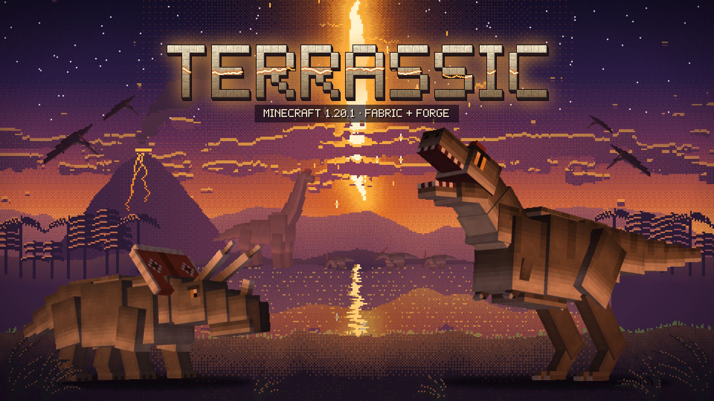
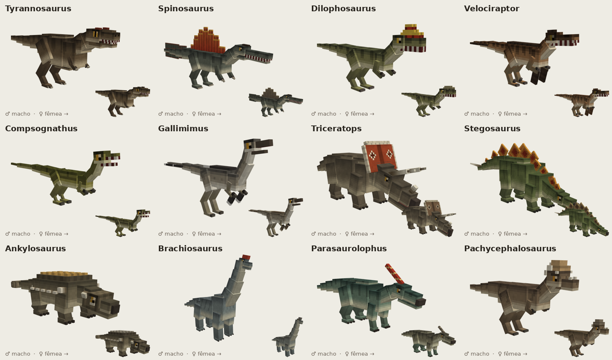
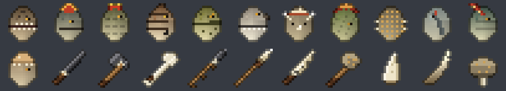

# Terrassic — v1.0.0



> **Terrassic** é um mod de dinossauros para Minecraft 1.20.1, em Fabric e Forge, feito do zero com modelos, texturas e história próprios. Um acidente no laboratório do Projeto Terrassic joga você no Cretáceo de mãos vazias, atrás da Dra. Katarina Usha, que atravessou o tempo antes de você. Cada criatura tem o tamanho real do maior fóssil conhecido (1 bloco = 1 metro), macho e fêmea, ovos que chocam e filhotes que marcam você como família. Dome, monte e voe; desenterre fósseis, preencha o Caderno de Campo e construa com o que a época oferece. Uma era de cada vez, sempre no seu ritmo: a história guia, mas nunca prende.
>
> Resumo em português, inglês e espanhol, e textos para a página do mod: [`docs/RESUMO.md`](docs/RESUMO.md).

Mod de dinossauros para **Minecraft 1.20.1** que roda em **Fabric e Forge** (multi-loader com Architectury). Os modelos 3D são animados no estilo do Cobblemon (cubos low-poly e animações GeckoLib) e foram reconstruídos a partir de medidas reais de fósseis.

Autor: **Rodrigo Gomes**. Modelos, texturas, sprites e código são autorais, gerados pelas ferramentas em `tools/`.

Projeto pessoal, sem vínculo empresarial. Para colaborar entre sessões de IA, leia
[`AGENTS.md`](AGENTS.md) e o [quadro de coordenação](docs/COORDENACAO.md).
Verificação de integridade sem gerar arquivos: `python3 -B tools/validation/check_project.py`.

## Links oficiais

- [Modrinth](https://modrinth.com/mod/terrassic)
- [CurseForge](https://www.curseforge.com/minecraft/mc-mods/terrassic)
- [Wiki no GitHub](https://github.com/RodrigoGomesDev/terrassic/wiki)

## Estado da main de desenvolvimento

A main contém 59 espécies, o sistema básico de nocaute e a identidade visual integrada, na versão `1.0.0`. O elenco e os exemplos abaixo descrevem a v0.2 original;
o estado das entregas e os testes atuais estão no [quadro de coordenação](docs/COORDENACAO.md) e no
[roadmap](docs/ROADMAP.md). Build, testes de servidor e aprovação visual são verificações distintas.





## Os 12 dinossauros

| Dinossauro | No jogo | Papel | Onde nasce | Comida | Montaria |
|---|---|---|---|---|---|
| **Tyrannosaurus** | ~6,6 blocos | Predador ápice, ruge ao escolher um alvo | Savana, selva (raro) | Carne de vaca, porco e ovelha | ✅ |
| **Spinosaurus** | ~7,5 blocos, com vela | Predador de rio: caça peixes, nada e não se afoga | Rio, pântano, mangue (raro) | Peixes | — |
| **Dilophosaurus** | ~4,5 blocos | Predador médio, exibe as cristas antes de atacar | Floresta, selva | Frango, coelho, ovelha, porco | — |
| **Velociraptor** | ~2 blocos, com penas | Caça em bando e salta no alvo; foge do T. rex | Savana, badlands, deserto | Carnes | — |
| **Compsognathus** | ~1,2 blocos | Arisco, mas o grupo ataca quem machuca um deles. Domesticável com peixe | Floresta, selva | Frango, bacalhau, salmão | — |
| **Gallimimus** | ~3,8 blocos | Corredor em bando que foge de tudo. **A montaria mais rápida** | Savana, planície, deserto | Sementes, frutas, maçã | ✅ |
| **Triceratops** | ~5,5 blocos | Herbívoro de manada, chifrada com muito knockback | Savana, planície | Trigo, samambaia | ✅ |
| **Stegosaurus** | ~4,5 blocos | Herbívoro que se defende com golpe de cauda | Floresta, planície | Samambaia, melancia, trigo | — |
| **Ankylosaurus** | ~4,5 blocos | Tanque blindado (armadura 16) com clava na cauda | Floresta, planície, badlands | Samambaia, frutas | — |
| **Brachiosaurus** | ~7 blocos, 5,3 de altura | Gigante pacífico que come folhas. **A montaria mais alta** | Savana, planície (raro) | Folhas | ✅ |
| **Parasaurolophus** | ~6 blocos | Herbívoro de crista; chama a manada e foge do perigo | Planície, floresta | Trigo, samambaia, frutas | ✅ |
| **Pachycephalosaurus** | ~3 blocos | Cabeçada com knockback enorme quando provocado | Taiga, colinas | Frutas, maçã | — |

### O que todos têm

- **Macho e fêmea.** O sexo é sorteado ao nascer e aparece na textura: o macho tem as cores de exibição (crista, vela, placas, babado), a fêmea é mais discreta. Algumas espécies também mudam de forma: crista maior no Parasaurolophus e no Dilophosaurus, vela mais alta no Spinosaurus, coroa de espinhos no Pachycephalosaurus. **Só um casal macho + fêmea procria.**
- **Ovos que chocam.** Ao procriar, a fêmea põe um ovo (bloco) perto dela. O ovo racha duas vezes e choca em alguns minutos. O filhote que nasce **marca o jogador mais próximo** (até 12 blocos) e já nasce domesticado. Ovos podem ser quebrados, levados e colocados em outro lugar.
- **Domesticação:**
  - **Herbívoros e Compsognathus:** dê a comida na mão; cada mordida tem 1 chance em 4 de domesticar.
  - **Predadores:** só aceitam comida quando são **filhotes**. Para ter um T. rex domesticado, crie um a partir de um ovo ou alimente um filhote.
  - **Domesticado:** com a mão vazia, o clique direito alterna entre **sentar** e **seguir**. Ele defende você e ataca o que você atacar. A comida também cura.
- **Montaria** (T. rex, Triceratops, Brachiosaurus, Parasaurolophus e Gallimimus):
  - Clique com uma **sela** no dinossauro domesticado e adulto.
  - Depois, clique com a mão vazia para montar e use WASD para andar.
  - Agache + clique com a mão vazia para mandar sentar.
- **Animações:** parado, andar, correr, atacar e **descansar** (deita quando está sentado), mais rugido, pastar, chamado e exibição. A cabeça acompanha o olhar.
- **Ovo gerador** com sprite próprio para cada espécie, spawn natural por bioma e loot.
- No modo **Pacífico**, predadores selvagens não procuram o jogador.

## Armas arcaicas

| Arma | Receita | Dano | Destaque |
|---|---|---|---|
| Faca de Sílex | sílex sobre graveto | 4,5 | rápida |
| Machadinha de Sílex | 3 sílex + 2 gravetos (formato de machado) | 7,5 | também corta madeira |
| Clava de Osso | bloco de osso + osso (diagonal) | 7,5 | empurra o alvo |
| **Lança de Sílex** | sílex + linha + graveto (diagonal) | 6 corpo a corpo / 7 arremessada | **segure o clique direito e solte para arremessar**, depois recolha |
| **Lança de Chifre** | chifre de tricerátops + linha + graveto | 8 / 10 arremessada | mais forte e durável |
| Adaga de Dente de T. rex | dente de T. rex sobre couro | 7 | rápida e forte |
| Clava de Cauda | clava de anquilossauro + graveto | 11 | lenta, empurra muito |

Os materiais caem dos dinossauros, com mais chance quando é o jogador quem mata:

- **Dente de Tiranossauro:** T. rex.
- **Chifre de Tricerátops:** Triceratops.
- **Clava Caudal de Anquilossauro:** Ankylosaurus.

Os sons ainda são placeholders do vanilla (ravager, sniffer, camelo, cabra, raposa, papagaio e outros, com pitch alterado).

## Como compilar e testar

Pré-requisito: **JDK 21** para rodar o Gradle. O mod é compilado para Java 17.

```bash
cd ~/projects/Terrassic
./gradlew :fabric:runClient     # abre o jogo com o mod (Fabric)
./gradlew :forge:runClient      # idem (Forge)
./gradlew build                 # jars em fabric/build/libs e forge/build/libs
```

Para jogar fora do ambiente de desenvolvimento, coloque o jar na pasta `mods` junto com **Architectury API 9.2.x** e **GeckoLib 4.x para 1.20.1**. No Fabric, inclua também a **Fabric API**.

Para testar rápido, use a aba criativa **Terrassic** ou comandos como `/summon terrassic:brachiosaurus`.

## Estrutura

```
Terrassic/
├── common/src/main/java/com/terrassic/
│   ├── entity/      DinosaurEntity (base: sexo, domesticação, montaria, ovos),
│   │                HerbivoreDinosaur, PredatorDinosaur, 12 espécies, ThrownSpear
│   ├── block/       DinoEggBlock (ovos que chocam)
│   ├── item/        armas (SpearItem, ClubItem, FlintHatchetItem) e ModTiers
│   ├── registry/    entidades, blocos, itens, aba criativa
│   ├── world/       spawns por bioma
│   └── client/      DinoGeoModel (textura por sexo, ossos male_/female_/saddle), renderers
├── common/src/main/resources/assets/terrassic/   modelos, animações, texturas, sprites, lang (pt_br/en_us)
├── fabric/  forge/  só o ponto de entrada de cada loader + metadados
├── art/<especie>/   ★ .bbmodel editáveis no Blockbench, texturas macho/fêmea, previews e GIFs
└── tools/
    ├── modelgen/    gerador procedural dos modelos 3D (Python + Blockbench headless)
    ├── spritegen/   gerador dos sprites 16×16 (ovos, armas, ovos-bloco)
    └── javagen/     gera as classes das espécies e os JSONs (lang, receitas, loot, modelos)
```

## Editando os modelos no Blockbench

1. Abra `art/<especie>/<especie>.bbmodel` no Blockbench. O formato é *Bedrock Entity* e não precisa de plugin. O projeto traz as duas texturas, macho e fêmea; para alternar, clique com o direito na textura e escolha *Use as default*.
2. Exporte por cima dos arquivos do mod:
   - **Export Bedrock Geometry** → `common/.../geo/entity/<especie>.geo.json`
   - **Export Animations** → `common/.../animations/entity/<especie>.animation.json`
   - Texturas → `common/.../textures/entity/<especie>_male.png` e `_female.png`

Ossos com nomes especiais:

| Osso | Comportamento |
|---|---|
| `head` | Girado pelo jogo (olhar). Não anime; use `skull`, `neck1` e `jaw` |
| `male_display` / `female_display` | Aparecem só no macho / só na fêmea |
| `saddle` | Aparece só quando o dinossauro está selado |

As animações seguem o padrão `animation.<especie>.<idle|walk|run|sit|attack|...>`.

Para **regenerar por código**, rode `tools/modelgen/build_all.py` para os modelos, `tools/spritegen/sprites.py` para os sprites e `tools/javagen/gen_species.py` / `gen_resources.py` para as classes e os JSONs. As instruções estão em `tools/modelgen/README.md`.

## Histórico (git)

O projeto é um repositório git com os commits no nome de Rodrigo Gomes:

- `v0.1.0`: 5 dinossauros
- `v0.2.0`: 12 dinossauros, sexo, ovos, domesticação, montaria e armas

Use `git log` para ver o histórico.

## Roadmap

- **v0.3**:
  - Fósseis no mundo e mesa de extração de DNA.
  - Pteranodon (voador) e Mosasaurus (aquático).
  - Sons próprios.
  - Montaria com pulo e tirar a sela.
  - Configuração de spawn.
- **v0.4**: Ciclo de fome e sono, territórios, variantes de cor por bioma, ninhos.
- **Portes**: 1.21.x. A lógica fica em `common/`; a principal mudança é a versão do GeckoLib e as APIs de item/registro.

## Licença

- **Código** (Java, scripts de `tools/`, build): **GNU LGPL 3.0** (`LICENSE` + `COPYING`).
- **Assets** (modelos, animações, texturas, sons, fontes próprias, logo, história, textos e nomes): **All Rights
  Reserved**, com permissões explícitas em `LICENSE-ASSETS.md`: **modpacks são livres** (baixando dos projetos oficiais
  no Modrinth e no CurseForge), vídeos e lives são livres com monetização, addons são livres sem usar os assets nem o
  logo. Ports não oficiais e reenvio do jar não são permitidos.
- Contribuições seguem o acordo em `CLA.md`.
- Autor e titular: Rodrigo Gomes.

NOT AN OFFICIAL MINECRAFT PRODUCT. NOT APPROVED BY OR ASSOCIATED WITH MOJANG OR MICROSOFT.

## Referências

Medidas e anatomia: Wikipedia (artigos de cada espécie) e a literatura citada neles. Nenhuma arte de terceiros foi copiada: as imagens serviram só como referência de proporção, e modelos, texturas e sprites foram gerados pelo código deste repositório.
